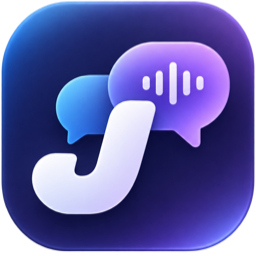

<p align="center">
  
</p>

<h1 align="center">Parlance</h1>

<p align="center"><strong>Your meetings. Your machine.</strong></p>
<p align="center">An open-source, local AI meeting assistant for live transcription,<br>real-time translation, and reply suggestions.</p>

<p align="center">
  <a href="https://github.com/FrandyAquino/jav-parlance/actions/workflows/ci.yml"></a>
  <a href="LICENSE"></a>
  <a href="#platform-support"></a>
  <a href="CONTRIBUTING.md"></a>
</p>

<p align="center">
  <a href="#try-parlance">Get started</a> ·
  <a href="#platform-support">Platform support</a> ·
  <a href="CONTRIBUTING.md">Contribute</a> ·
  <a href="docs/roadmap.md">Roadmap</a> ·
  <a href="https://github.com/FrandyAquino/jav-parlance/issues/new/choose">Report an issue</a>
</p>

Follow a conversation in another language without sending meeting audio to a cloud
transcription service. Parlance listens to audio on your computer, turns speech into
live text, and shows a translation alongside it. When it detects a question, a local
copilot drafts a reply for you to review.

**No account, subscription, or paid API key.** Download the models once, then run
speech recognition and language inference on your own hardware.

## What you can do

- **Read live captions.** Streaming Whisper transcribes speech with automatic
  language detection and revises partial text as the speaker continues.
- **Follow both languages.** Keep the original transcript and its translation side
  by side in a floating, always-on-top desktop window.
- **Get help replying.** A question-aware copilot suggests responses in the
  speaker's language and yours. You decide what to say.
- **Prepare answers without a call.** Type or paste a question, add an optional
  draft idea, and ask the same local copilot without starting audio capture.
- **Bring your project context.** Save local profiles describing your stack and
  team decisions. Responses retain the profile attribution used to generate them.
- **Keep an answer in view.** Switch between compact subtitles, preparation, and
  a pinned reading view without restarting capture or replacing your chosen reply.
- **Choose your audio source.** Capture system audio, an application, or a
  microphone. A Chromium tab-capture extension is also implemented; see the
  verification limits below.
- **Choose what stays.** Meeting history is off by default. Enable local text
  history when you want it; the app does not save captured audio.
- **Run your own models.** Start with Whisper base and Qwen3.5 2B, or choose larger
  catalog models when your hardware allows it.

Parlance captures audio at the operating-system level, so native system capture
does not require a meeting bot to join the call or an integration with each meeting
service. Respect participants' consent and your organization's meeting policies.

## Try Parlance

**Parlance is in early development. There are no published releases yet.** The
supported starting point is a source build. CI produces development installers;
these are not a signed, notarized release channel.

### Develop

Install stable Rust, Node.js 22+, the pnpm version declared in
[`package.json`](package.json), CMake, a C/C++ compiler, and libclang. Follow the
platform guide before building:

- [Windows: MSVC or MinGW setup](docs/platform/windows.md)
- [macOS: Xcode tools, permissions, and Metal](docs/platform/macos.md)
- [Linux: WebKitGTK and audio packages](docs/platform/linux.md)

```sh
git clone https://github.com/FrandyAquino/jav-parlance.git
cd jav-parlance
pnpm install --frozen-lockfile
pnpm dev
```

On macOS, `./scripts/setup-macos.sh` checks prerequisites, installs project
dependencies, and builds the workspace before you run `pnpm dev`.

### Start a session

1. Open **Settings → Models** and download the speech, voice-activity, language,
   and LLM runtime models. The default downloads total roughly **1.4 GB**.
2. Select an audio source and your translation language.
3. Grant the audio or microphone permissions requested by your OS, then start
   listening. Play speech through the selected source to see the live transcript.

Models are verified against pinned SHA-256 hashes. Initial downloads need internet
access; transcription, translation, and reply generation run locally afterwards.
Latency and memory use depend on your CPU, GPU, model size, and audio workload.

### Development installers

Open a successful [CI run](https://github.com/FrandyAquino/jav-parlance/actions/workflows/ci.yml)
and download its `parlance-Windows`, `parlance-macOS`, or `parlance-Linux` artifact.
GitHub requires sign-in to download workflow artifacts, which expire after seven
days. Availability depends on a successful installer job.

Mac development bundles use ad-hoc signing and are not notarized. See the
[macOS build guide](docs/platform/macos.md#build-and-install) for distribution
limitations; do not disable Gatekeeper to install a development build.

## Platform support

Build coverage and real-device verification are different. This is the current
state, with the detailed [roadmap](docs/roadmap.md) tracking remaining work.

| Platform | What has been verified | What still needs testing |
| --- | --- | --- |
| **Windows** | Windows 11 system-audio transcription, translation, and copilot on real hardware | Live per-app capture and microphone mixing; broader hardware coverage |
| **macOS** | Apple Silicon system/app/microphone capture and live transcription/translation; universal app build | Intel hardware, macOS 13.3–14.1 capture fallback, and signed release acceptance |
| **Linux** | Compilation and automated checks; PulseAudio/PipeWire adapter implemented | Real desktop capture and end-to-end runtime acceptance |
| **Chromium extension** | Tab-capture bridge, native host, and isolated automated tests | A complete session in a real Chrome or Edge browser |

macOS supports 13.3+; system/app capture uses Core Audio taps on 14.2+ and a
ScreenCaptureKit fallback on earlier supported versions. Windows per-app capture
requires build 20348 or later. See the platform guides for exact requirements.

Evidence: [Windows](docs/benchmarks/2026-11-24-windows-baseline.md) ·
[macOS](docs/benchmarks/2026-11-25-macos.md) ·
[Contextual copilot](docs/benchmarks/2026-11-25-adaptive-copilot.md) ·
[Browser extension setup](apps/extension/README.md).

## Privacy and local models

Audio, transcripts, translations, and suggested replies stay on your device.
Captured audio is held in memory, not recorded to disk. Optional history stores
text locally in SQLite. The app contacts external services to download the models
and runtime you choose; inference does not use a hosted API.

| Component | Default | Download | License |
| --- | --- | --- | --- |
| Speech recognition | Whisper base Q8 via whisper.cpp | 82 MB | MIT |
| Voice activity detection | Silero VAD v5.1.2 | 0.9 MB | MIT |
| Translation and replies | Qwen3.5 2B Instruct Q4_K_M | 1.3 GB | Apache-2.0 |
| Local LLM runtime | llama.cpp `llama-server` b12686 | 25–40 MB | MIT |

Whisper small / large-v3-turbo and Qwen3.5 4B are also available in the model
catalog. Models can mistranscribe speech or generate incorrect replies; review
their output before relying on it.

Read the [security architecture](docs/security.md),
[model and runtime licenses](docs/research/model-licenses.md), or
[report a vulnerability privately](SECURITY.md).

## Under the hood

**Rust + Tauri 2 + React**, with Whisper for speech recognition and Qwen through
llama.cpp for translation and replies.

```text
System / app / microphone / browser-tab audio
                       │
                Resample to 16 kHz
                       │
               Silero voice detection
                       │
               Streaming Whisper
                       │
              Transcript + local Qwen
                       │
            Translation + reply suggestions
                       │
                Floating desktop UI
```

The Rust workspace separates domain types, audio capture, recognition, language
inference, storage, and session orchestration. IPC types are generated from Rust
for the TypeScript frontend.

Explore the [architecture](docs/architecture/overview.md),
[IPC contracts](docs/architecture/ipc.md), [concurrency model](docs/architecture/concurrency.md),
and [decision records](docs/adr/).

<details>
<summary><strong>Headless CLI examples</strong></summary>

```sh
cargo run --release -p parlance-cli -- sources
cargo run --release -p parlance-cli -- listen --source system:default --seconds 30
cargo run --release -p parlance-cli -- bench fixtures/audio/jfk.wav --reference "..."
```

The CLI uses the same capture and inference crates as the desktop app.

</details>

## Help build Parlance

Contributions are welcome, including work that does not involve writing code:

- **Test a platform:** Linux audio, Intel Macs, older supported macOS versions,
  and real browser-tab sessions need hands-on validation.
- **Improve onboarding:** try the build instructions on a clean machine and report
  the exact step that needs clarification.
- **Improve speech and translation:** report reproducible language-detection,
  latency, or transcription problems using synthetic or public-domain speech.
- **Improve accessibility and UX:** keyboard navigation, readable captions, and
  clear permission errors make a practical difference.

Start with the [contribution guide](CONTRIBUTING.md), browse
[open issues](https://github.com/FrandyAquino/jav-parlance/issues), or
[propose an improvement](https://github.com/FrandyAquino/jav-parlance/issues/new?template=feature_request.yml).
Keep PRs focused. CI checks Rust on three operating systems, both frontends, and
development installers; maintainers review changes before merging.

If Parlance is useful to you, a star helps other people discover it. Reproducible
bug reports and platform testing help make it better.

## License and acknowledgments

Parlance is [MIT licensed](LICENSE). Model weights and bundled third-party
components retain their own licenses; see the [license notes](docs/research/model-licenses.md)
and [Google Sans Flex license](apps/desktop/src/assets/fonts/OFL.txt).

Built on [Whisper](https://github.com/openai/whisper),
[whisper.cpp](https://github.com/ggml-org/whisper.cpp),
[Silero VAD](https://github.com/snakers4/silero-vad),
[Qwen](https://github.com/QwenLM/Qwen3.5),
[llama.cpp](https://github.com/ggml-org/llama.cpp), and
[Tauri](https://github.com/tauri-apps/tauri).
