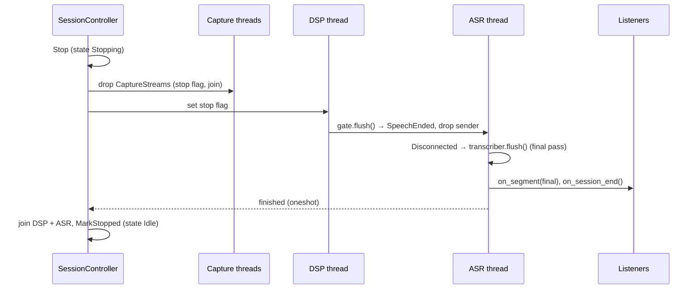

# Concurrency

The rule: **speech recognition must never wait on anything slower than itself.** Capture feeds a lock-free ring,
DSP feeds ASR through a bounded queue, and everything downstream of ASR (translation, copilot, history) is a
non-blocking hand-off.

## Threads and tasks

| Name | Kind | May | Must not |
| --- | --- | --- | --- |
| `parlance-wasapi-capture` | OS thread, COM MTA (`crates/capture/src/windows/stream.rs`) | Wait on the WASAPI event (100 ms timeout), copy packets into reused buffers, `AudioSink::push`, inject silence, reopen the device | Lock, do I/O, run inference, block on the consumer |
| `parlance-parec` | OS thread + `parec` child (`linux/stream.rs`) | Read 10 ms chunks from the pipe, convert, push, restart `parec` | Same as above |
| `parlance-bridge` | OS thread (`bridge.rs`) | Accept loopback TCP connections and spawn one handler each | Read audio itself |
| `parlance-bridge-conn` | OS thread per tab | Authenticate (5 s hello timeout), decode base64 PCM16, push into the attached sink (short mutex on the sink slot) | Block on the session |
| Replay thread | OS thread (`replay.rs`, tests/bench only) | Pace 10 ms chunks; retry pushes so no audio is lost | — |
| `parlance-dsp` | OS thread (`session/src/dsp.rs`) | Drain rings, downmix, resample, mix, meter, run the VAD, `send` gate events (blocks when the ASR queue is full) | Decode speech, talk to the LLM |
| `parlance-asr` | OS thread (`session/src/asr_worker.rs`) | Decode with whisper.cpp, emit events, call `SegmentListener::on_segment` | Await anything; listeners must return immediately |
| Translation worker | Tokio task (`translation/src/worker.rs`) | Keep final translations ordered and interleave the newest live partial | Be awaited by the ASR thread |
| Copilot service | One Tokio task (`copilot/src/service.rs`) | Generate and translate one request; retain latest pending automatic question behind manual work | Outlive cancellation or block ASR |
| `parlance-history` | OS thread (`storage/src/recorder.rs`) | Own the SQLite connection and write final lines/translations | Be called synchronously from ASR |
| LLM supervisor | Tokio task (`llm/src/server.rs`) | Spawn/kill `llama-server`, poll `/health`, back off | — |
| Log forwarders | Tokio tasks | Forward sidecar stdout/stderr to `tracing` at debug | — |
| Tauri commands | Main thread (sync) / Tokio (async) | Validate, delegate, map errors. Blocking work goes to `spawn_blocking` (`list_sources`, pipeline start/stop) | Hold locks across `.await` |

## Bounded queues and capacities

| Queue | Type | Capacity (constant) | Full behaviour |
| --- | --- | --- | --- |
| Capture → DSP | `rtrb` SPSC ring per source | `RING_CAPACITY` = 48 000 × 2 × 10 samples (10 s of 48 kHz stereo), `session/src/pipeline.rs` | Newest samples dropped and counted (`AudioSink::push` never blocks). DSP reports drops as a warning notice at most every 5 s (`DROP_REPORT_INTERVAL`) |
| DSP → ASR | `std::sync::mpsc::sync_channel` of `GateEvent` | `ASR_QUEUE` = 512 | DSP blocks on `send`; the ring absorbs the stall, then overflows as above |
| ASR → translation | `tokio::sync::mpsc` | `QUEUE` = 64 (`translation/src/worker.rs`) | `try_send` fails, the line is skipped, one "falling behind" warning per session |
| ASR/manual → copilot | App service active/pending slots + `Notify` | One active, one latest automatic pending; automatic policy 4 s / ≥12 chars | Manual supersedes active; automatic replaces pending while manual runs; replaced requests emit cancelled |
| ASR → copilot conversation ingress | Nonblocking snapshot handoff | 64 final segments | Oldest queued segment is evicted when full; contention drops the incoming update; a notice and context-omission flag disclose loss |
| ASR → history | `std::sync::mpsc::channel` | unbounded (final lines only) | n/a |
| Mixer lag | `StreamMixer` | `MAX_MIX_LAG` = 16 000 / 4 samples (250 ms) | A lagging source is padded with silence |
| Events → UI | `EventHub` → Tauri `Channel` | n/a | Dropped while no window is subscribed; UI resyncs state on `subscribe` |

Other tunables: level window 800 samples (20 Hz), DSP idle sleep 10 ms, ASR poll 50 ms, partial step 500 ms,
min partial 500 ms, VAD gate 0.5/0.35 thresholds, 600 ms min silence, 200 ms pre-roll, 20 s max utterance.

## Backpressure

1. Slow ASR → the ASR worker drains every queued event before decoding, so it decodes one larger step instead of
   several stale ones (ADR 0002).
2. ASR queue full → DSP blocks → rings fill → capture drops the newest audio and the UI gets
   `audio pipeline overloaded: N samples dropped`.
3. Slow LLM → translation queue fills → lines are skipped with one notice. The copilot cancels superseded work.

## Priority of ASR over AI work

- ASR runs on a dedicated OS thread; translation and copilot run on the Tokio pool and talk to a separate process.
- CPU budget: whisper uses `cores / 2` threads (1–8, `WhisperConfig::default`); `llama-server` gets
  `max(cores / 4, 2)` threads and `--n-gpu-layers 99` so it lives on the GPU when one is available.
- `llama-server` runs with `--parallel 2` (8 192 tokens shared), so a translation and a suggestion can run at once.
  There is **no request-level prioritisation** between translation and copilot yet (ADR 0005 states translation is
  scheduled first; that scheduler is planned).
- Partials use one latest-wins slot. After each final translation, the worker gives the newest live partial
  a turn before the next queued final. A final, a retracted utterance, a new segment or corrected source language
  cancels an obsolete in-flight partial. Same-segment word additions do not repeatedly restart generation.
- A completed preview remains visible while a replacement streams a shorter/different prefix. Appended text
  can stream immediately; a completed corrected result may still replace or shorten the prior preview.

## Cancellation

- `CancellationToken` everywhere on the async side. `LanguageModel::generate` selects on the token and drops the
  HTTP response, which makes `llama-server` abort the generation and free its slot.
- Copilot: manual work takes precedence over automatic work. Ending a session cancels its automatic work and fences old adapters, while manual work can finish. A new session clears recent conversation; shutdown cancels all work and joins the service task.
- LLM cancellation includes readiness and HTTP headers as well as SSE. A premature stream ending or token-limit finish is an error, not a complete reply.
- Translation: `on_session_end` closes the queue so final jobs can drain. Obsolete partial futures are cancelled
  and dropped, including while waiting for model readiness/HTTP headers; intentional preemption emits no error.
- Downloads: `cancel_download` cancels the token for that id; the partial file is removed.

## Shutdown ordering (`RunningPipeline::shutdown`, called from `SessionController::stop`)

The same path runs automatically when every source ends: producers are abandoned → DSP exits → ASR finishes →
the controller's watcher task calls `stop()`.

App exit (`RunEvent::ExitRequested`) prevents exit until the active start/stop request settles, stops capture,
allows final translations/history up to 15 seconds to drain, then awaits LLM termination and joins writers.
A bounded `RunEvent::Exit` fallback handles native macOS Quit paths that bypass `ExitRequested`. Total
shutdown has a 30-second deadline; a timeout is logged as potentially incomplete history. New sessions are rejected while closing.
Windows uses a Job Object with `KILL_ON_JOB_CLOSE`; Unix uses a guardian whose lifetime pipe closes even if the
app is SIGKILLed. The guardian terminates the sidecar on EOF.

## Failure supervision

**llama-server** (`crates/llm/src/server.rs`):

- Free loopback port + random 48-hex API key per launch; `/health` polled every 500 ms for up to 180 s.
- One warm-up completion (`max_tokens: 1`) before reporting `Ready`, to pay shader compilation up front.
- Exit during start-up → `FailedToStart`; exit after ready → `Exited` (backoff reset to 1 s).
- Backoff 1 s doubling to 30 s (`MAX_BACKOFF`) between attempts; status published on a `watch` channel
  (`Starting`, `Ready { gpu }`, `Restarting { reason }`, `Stopped`).
- After 2 failed GPU starts (`GPU_ATTEMPTS`), retries with `--n-gpu-layers 0` (CPU) for the rest of the
  supervisor's life.
- Requests wait at most 2 s for readiness (`READY_WAIT`), then fail with `Unavailable`; translation reports the
  first failure once per session.

**WASAPI** (`crates/capture/src/windows/stream.rs`):

- Endpoint sources (`system:*`, `mic:*`) reopen on loss every 500 ms, up to 40 attempts (~20 s), emitting
  `DeviceLost` → `Reconnected` or `Failed`. `default` re-resolves the current default device.
- Process loopback (`app:<pid>`) does not reconnect; it fails with "captured application stopped".
- Loopback delivers no packets in silence; the thread injects zeros for elapsed time (≥ 100 ms) to keep
  timestamps aligned with wall-clock time.
- Errors at first open are returned synchronously from `start` (e.g. `PermissionDenied` for a blocked mic).

**Linux parec**: restart after exit every 500 ms, up to 40 times; `app:<index>` does not reconnect.

**macOS**: a monitor checks device/default/format changes outside the callback every 100 ms. A change or
source termination produces `Failed` and releases the ring producer. Restart the session explicitly. Dropping
the stream fences callbacks, destroys native resources, and joins the monitor before freeing its callback state.

Capture events become UI notices (`DeviceLost` → warning, `Reconnected` → info, `Failed` → error).

## Known gaps

- The bridge accept thread never exits and does not limit concurrent connections.
