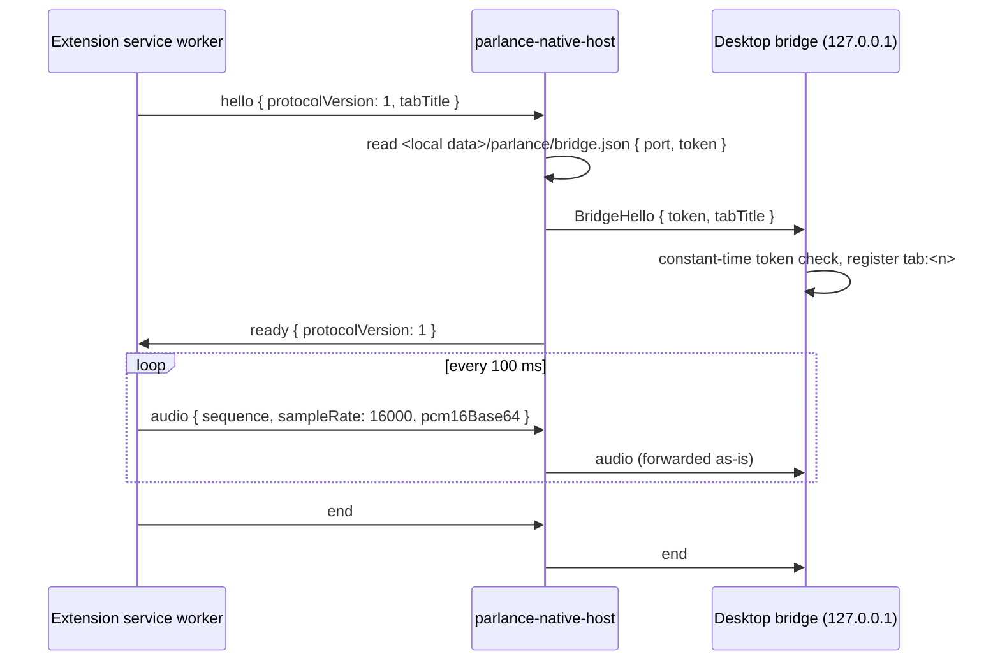

# IPC

Three boundaries, all typed in Rust:

1. **Webview ↔ core**: Tauri commands plus one `SessionEvent` channel.
2. **Extension ↔ native host**: Chromium native messaging (stdio).
3. **Native host ↔ desktop app**: loopback TCP bridge authenticated by a token.

## Tauri commands

Source: `apps/desktop/src-tauri/src/commands.rs`, registered in `lib.rs` (`generate_handler!`) and listed in
`build.rs` `COMMANDS`. The TS facade is `apps/desktop/src/lib/ipc.ts`. Argument names are camelCase on the JS side.
Errors are always `IpcError { code: ErrorCode, message }`.

| Command | Args | Result | Errors |
| --- | --- | --- | --- |
| `app_info` | — | `AppInfo` (version, platform, capture backend, `CaptureSupport`, whisper system info, models dir) | — |
| `list_sources` | — | `SourceDescriptor[]` (runs in `spawn_blocking`) | `invalidRequest` (unknown source), `captureUnavailable`, `permissionDenied` |
| `get_settings` | — | `AppSettings` | — |
| `update_settings` | `settings: AppSettings` | `AppSettings` (saved; LLM sidecar reconciled) | `invalidRequest` (unknown `speechModel`/`languageModel`, or write failure) |
| `list_models` | — | `ModelDescriptor[]` | — |
| `download_model` | `id`, `onProgress: Channel<ModelProgress>` | `null` when verified and installed | `invalidRequest` (unknown id, already downloading, cancelled), `network`, `modelCorrupt` (size/SHA-256 mismatch), `storage` |
| `cancel_download` | `id` | `null` | — |
| `subscribe` | `onEvent: Channel<SessionEvent>` | `null`; immediately replays `stateChanged` | — |
| `session_state` | — | `SessionState` | — |
| `start_session` | `request: StartSessionRequest { sourceId, microphoneId? }` | `null` once `running` | `invalidState`, `invalidRequest` (source not found), `captureUnavailable`, `permissionDenied`, `inferenceFailed` (model missing or failed to load), `internal` |
| `stop_session` | — | `null` once `idle` | `invalidState`, `internal` |
| `pause_session` | — | `null` | `invalidState` |
| `resume_session` | — | `null` | `invalidState` |
| `list_history` | — | `HistoryEntry[]` (latest 50) | `storage` |
| `history_transcript` | `id: number` | `HistoryLine[]` | `storage` |
| `delete_history` | `id: number` | `null` | `storage` |
| `list_project_profiles` | — | `ProjectProfiles { profiles, activeProfileId }` | `storage` |
| `save_project_profile` | `request: { id: string or null, name, content }` | Updated `ProjectProfiles` | `invalidRequest`, `storage` |
| `delete_project_profile` | `id: string` | Updated `ProjectProfiles`; deleting active clears selection | `invalidRequest`, `storage` |
| `set_active_project_profile` | `id: string or null` | Updated `ProjectProfiles` | `invalidRequest`, `storage` |
| `ask_copilot` | `request: { requestId, question, idea, replyLanguage, userLanguage, profileId }` | `null` after admission; result via suggestion events | `invalidRequest`, `contextTooLarge`, `modelMissing`, `storage` |
| `cancel_copilot` | `requestId: string` | `null`; idempotent cancellation | — |

Error mapping lives in `src-tauri/src/error.rs` (`from_capture`, `from_session`, `from_download`).

### Adding a command

1. Implement it in `commands.rs` (thin: validate, delegate, map errors).
2. Add it to `generate_handler!` in `lib.rs`.
3. Add the name to `COMMANDS` in `build.rs` (generates `permissions/autogenerated/<name>.toml`).
4. Grant `allow-<name-with-hyphens>` in `capabilities/default.json`.
5. Add any new types to `crates/protocol` (or `domain`) with `#[ts(export)]`, run `cargo test`, then add the
   wrapper to `src/lib/ipc.ts`.

## Session events

One channel per window (`EventHub` keeps the latest subscriber). `SessionEvent` is internally tagged
(`type`, camelCase):

| `type` | Payload | Emitted by | Rate |
| --- | --- | --- | --- |
| `stateChanged` | `state: SessionState` (`{ state: "idle" \| "starting" \| "running" \| "paused" \| "stopping" } \| { state: "failed", reason }`) | `SessionController` on every transition, and `subscribe` | On change |
| `level` | `level: AudioLevel { rmsDb, peakDb }` | DSP thread | 20 Hz while capturing (also while paused) |
| `transcript` | `segment: TranscriptSegment { id, revision, stableText, unstableText, language, startMs, endMs, stability }` | ASR thread | Each partial pass (~1/s per open utterance) and each final |
| `translation` | `translation: Translation { segmentId, sourceRevision, targetLanguage, text, isFinal }` | Translation worker | Per streamed token, then final |
| `suggestion` | `suggestion: Suggestion` including request identity, origin, nullable segment, profile attribution, status/error and bilingual text | App-owned copilot | Admission, streamed tokens, terminal result |
| `languageDetected` | `language: string` | ASR thread | When a final segment's language differs from the previous one |
| `notice` | `notice: { level: "info" \| "warning" \| "error", message }` | Anyone | Rare |

UI rules (`apps/desktop/src/store/session.ts`): replace segments by `id` when `revision` is newer; drop finals with
empty text; keep the translation with the highest `sourceRevision`; cap at 1 500 rows and 3 notices.
Suggestion events go directly to `store/copilot.ts`, which retains the latest automatic result, the matching manual result and a frozen pinned copy. Terminal results reject later updates for that identity. Starting capture never resets this work store.

Manual request IDs are created before invocation, so events arriving before command acknowledgement remain correlated. `questionSegmentId` is null for written questions. The result's `profile` contains the captured ID, name and revision; `conversationTruncated` discloses omitted conversation. `status` is queued, generating, complete, failed or cancelled; `isComplete` is true only for complete.

Model download progress uses a separate per-call `Channel<ModelProgress>` (about every MiB, then `done`).

## Generated contracts

- Types derive `ts_rs::TS` with `#[ts(export)]` in `crates/domain`, `crates/protocol` and `crates/storage`
  (`HistoryEntry`, `HistoryLine`).
- `.cargo/config.toml` sets `TS_RS_EXPORT_DIR = apps/desktop/src/bindings` (relative to the workspace), so
  `cargo test` writes one `.ts` file per type there. Never edit them by hand; ESLint ignores the folder.
- 64-bit integers carry `#[ts(type = "number")]` because serde writes JSON numbers.
- CI regenerates and fails on drift (`git diff --exit-code apps/desktop/src/bindings`).
- The extension imports the same bindings for `ExtensionMessage`/`HostMessage`. Constants ts-rs cannot export
  (`PROTOCOL_VERSION`, `BRIDGE_SAMPLE_RATE`, `MAX_MESSAGE_BYTES`) are mirrored in
  `apps/extension/src/lib/constants.ts`; keep them in sync by hand.

## Capability and permission model

- `tauri.conf.json`: `withGlobalTauri: false`, `freezePrototype: true`, CSP
  `default-src 'self'; connect-src ipc: http://ipc.localhost; img-src 'self' data:; style-src 'self' 'unsafe-inline'; script-src 'self'`.
- `capabilities/default.json` applies to window `main` only and grants:
  - `core:event:default`
  - window chrome: `start-dragging`, `set-always-on-top`, `is-always-on-top`, `minimize`, `close`, `toggle-maximize`
  - adaptive geometry: `inner-size`, `scale-factor`, `current-monitor`, `outer-position`, `set-size`, `set-position`
  - one `allow-<command>` per Parlance command.
- No filesystem, shell, HTTP or dialog plugin is enabled. Anything not granted is rejected by Tauri.

## Browser bridge protocol

- **Framing** (both hops, `protocol::native_messaging`): u32 length in native byte order + UTF-8 JSON,
  max 1 MiB (`MAX_MESSAGE_BYTES`) in both directions; checked before allocating.
- **Messages**: extension → host `hello | audio | end`; host → extension `ready | unavailable { reason } | error { message }`.
  Unknown `type` values fail deserialization. The host rejects a protocol mismatch, a non-hello first message,
  a second hello and any sample rate other than 16 000 Hz.
- **Discovery file**: the desktop app binds `127.0.0.1:0`, generates a 24-byte random token (48 hex chars) and
  writes `{ port, token }` to `<local data dir>/parlance/bridge.json` (`%LOCALAPPDATA%` on Windows; mode `0600`
  on Unix). The file is removed when the backend is dropped.
- **Authentication**: first frame must be `BridgeHello` within 5 s; tokens are compared without early exit.
  Each authenticated connection appears as source `tab:<n>` (kind `browserTab`, name = tab title or
  "Browser tab") and disappears when the connection ends.
- **Native messaging host**: `app.parlance.native_host`; `parlance-native-host --install <extension-id>`
  writes a manifest whose `allowed_origins` is exactly `chrome-extension://<id>/` for Chrome and Edge
  (Windows: `HKCU\Software\{Google\Chrome,Microsoft\Edge}\NativeMessagingHosts\…`; macOS/Linux: per-user
  `NativeMessagingHosts` directories). The host logs to stderr only.
- User-facing failures (`unavailable` reasons) are actionable strings from `apps/native-host/src/bridge.rs`.

See [ADR 0010](../adr/0010-browser-tab-bridge.md) and [browser-extension.md](../platform/browser-extension.md).
