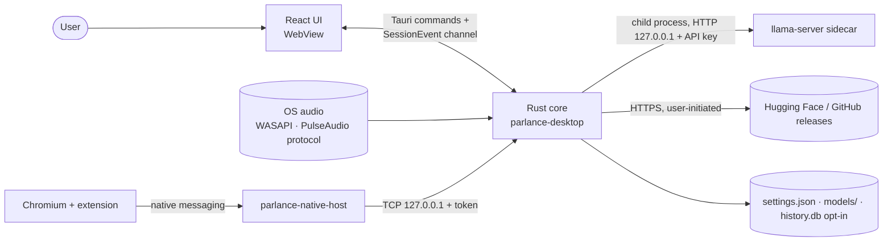
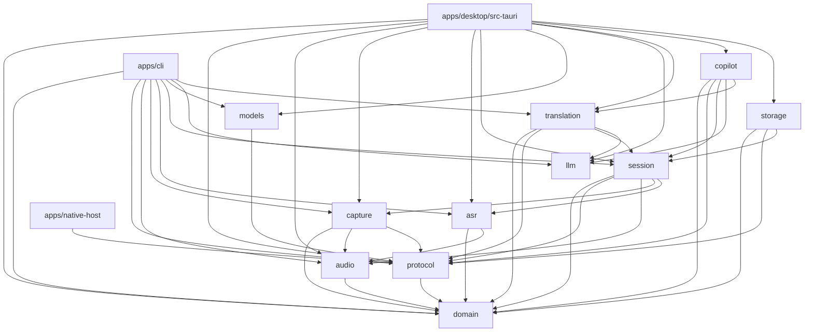
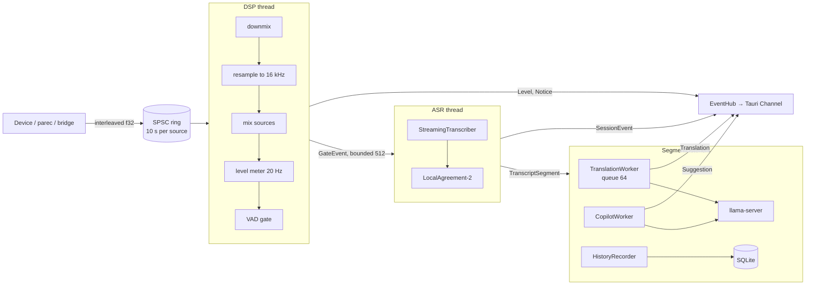
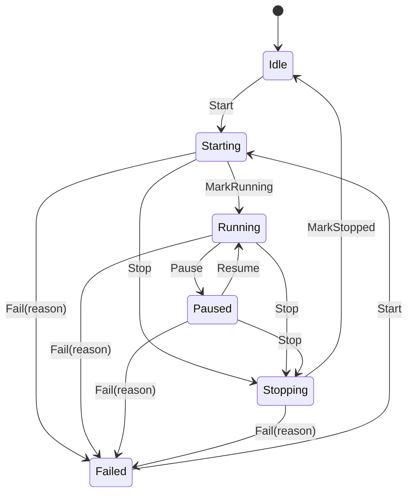

# Architecture overview

Parlance is a single-user desktop app. Audio is captured, transcribed, translated and answered on the
device. The only network traffic is the model downloads the user starts.

## System context

- Raw audio never crosses into the webview. The UI receives only typed events (ADR 0001).
- `apps/cli` reuses the same core crates headlessly (`sources`, `listen`, `bench`, `models`, `download`, `llm`).

## Crate map

| Crate | Responsibility | Must not |
| --- | --- | --- |
| `crates/domain` | Pure types: `SourceId/Kind`, `TranscriptSegment`, `Translation`, `Suggestion`, `LanguageCode`, `SessionState` machine | Do I/O or depend on other crates |
| `crates/protocol` | Wire contracts (`SessionEvent`, `IpcError`, `AppSettings`, models, native messaging framing). ts-rs export | Contain behaviour beyond (de)serialization and framing |
| `crates/audio` | Lock-free ring (`rtrb`), downmix, i16→f32, resampling (`rubato`), mixer, level meter, VAD port + hysteresis gate | Know about devices or models |
| `crates/capture` | `CaptureBackend` port, WASAPI (Windows), pactl/parec (Linux), browser bridge, replay, composite router | Do inference, I/O beyond the device, or block in the device loop |
| `crates/asr` | `SpeechRecognizer` port, LocalAgreement-2, `StreamingTranscriber`, whisper.cpp + Silero adapters (feature `whisper`), WER metric | Know about sessions or the UI |
| `crates/session` | `SessionController` (state machine owner), DSP and ASR threads, `SpeechEngine` / `SegmentListener` / `EventSink` ports | Talk to LLMs or storage directly (only via listeners) |
| `crates/llm` | `LanguageModel` port, `LlamaServer` supervisor, SSE client, prompt isolation | Depend on any Parlance crate |
| `crates/translation` | `Translator` port, `LlmTranslator`, `TranslationWorker` listener | Block the ASR thread |
| `crates/copilot` | Question detector, suggestion policy, rolling context, `CopilotWorker` listener | Block the ASR thread |
| `crates/storage` | Opt-in SQLite history, `HistoryRecorder` listener with its own writer thread | Store audio |
| `crates/models` | Pinned catalog (URL, size, SHA-256), verified download, `ModelStore` | Load models |
| `apps/desktop/src-tauri` | Composition root, Tauri commands, event hub, settings, LLM lifecycle (`intelligence.rs`) | Contain business logic |
| `apps/cli` | Headless developer tool and benchmarks | — |
| `apps/native-host` | Chromium native messaging host; relays tab audio to the desktop bridge | Depend on anything but `protocol` |

### Dependency graph (from `Cargo.toml`)

Allowed directions:

- Dependencies point toward `domain`. `domain` depends on nothing internal; `llm` depends on nothing internal.
- `translation`, `copilot` and `storage` depend on `session` only for the `SegmentListener`/`EventSink` ports.
  `session` never depends on them; the composition root injects them as listeners.
- Only `apps/*` may depend on `tauri`, `clap` or wire everything together. Core crates have no Tauri dependency.
- `parlance-asr` is pulled in with `default-features = false` at workspace level; apps opt into `whisper`
  (and `cuda` / `metal` / `vulkan` through the desktop crate's features).

## Runtime components

| Component | Kind | Owner | Lifetime |
| --- | --- | --- | --- |
| Tauri main thread + webview | OS thread | Tauri | App |
| Tokio runtime (Tauri async runtime) | thread pool | Tauri | App |
| `parlance-wasapi-capture` / `parlance-parec` | OS thread per source | `CaptureStream` | Session |
| `parec` | child process per source (Linux) | `ParecStream` | Session |
| `parlance-dsp` | OS thread | `RunningPipeline` | Session |
| `parlance-asr` | OS thread | `RunningPipeline` | Session |
| Translation worker | Tokio task | `TranslationWorker` | Session |
| Copilot dispatcher + one task per suggestion | Tokio tasks | `CopilotWorker` | Session |
| `parlance-history` | OS thread | `HistoryRecorder` (only if history is on) | Session |
| LLM supervisor + log forwarders | Tokio tasks | `LlamaServer` | While translation or copilot is enabled and models are installed |
| `llama-server` | child process | `LlamaServer` (Job Object on Windows) | Same |
| `parlance-bridge` (accept) + `parlance-bridge-conn` (one per tab) | OS threads | `BridgeBackend` | App / per connection |
| Model downloads | Tokio tasks (command futures) | `download_model` | Per download |

Details, queue sizes and shutdown order: [concurrency.md](concurrency.md).

## Streaming data flow

Per utterance:

1. The VAD gate emits `SpeechStarted` (with 200 ms pre-roll), `Speech(samples)`, `SpeechEnded` (600 ms silence or
   20 s cap). Silero via whisper.cpp; energy VAD when the Silero model is missing.
2. While open, the utterance is re-decoded after every 1 s of new audio once it is ≥ 700 ms long, with a reduced
   `audio_ctx` ("fast" pass). LocalAgreement-2 commits the prefix two consecutive hypotheses agree on.
3. On close, a full-context pass produces the `Final` revision; the committed prefix stays frozen.
4. Segment ids are stable; `revision` increases monotonically; the UI replaces rows in place.
5. Final segments go to translation (in order, two previous lines as chat context) and to the copilot
   (question detection → reply in the speaker's language → translation into the user's language).

## Session state machine

From `crates/domain/src/session.rs`. Every transition emits `SessionEvent::StateChanged`.

- `is_capturing()` is true only in `Running`; `is_active()` is true in `Starting`, `Running`, `Paused`.
- `SessionController::start` fails the session (`Fail`) if a source or model cannot be opened.
- When every capture stream ends, the controller emits a warning notice and stops itself (generation-guarded so a
  stale signal cannot stop a newer session).
- While `Paused`, audio is still metered but the gate is flushed and nothing reaches ASR.

## Platform status

| Platform | Native capture | Status |
| --- | --- | --- |
| Windows 10/11 | WASAPI endpoint loopback, process loopback (build ≥ 20348), microphones | Verified end-to-end |
| Linux | `pactl`/`parec` over the PulseAudio protocol (PulseAudio or pipewire-pulse) | Compiles, never run |
| macOS | none (`platform_backend()` returns `Unsupported`) | Planned: Core Audio taps |
| Any Chromium browser | MV3 extension + native host + bridge | Tests pass; not yet loaded in a real browser |

See [`docs/platform/`](../platform/) and the ADRs in [`docs/adr/`](../adr/).
