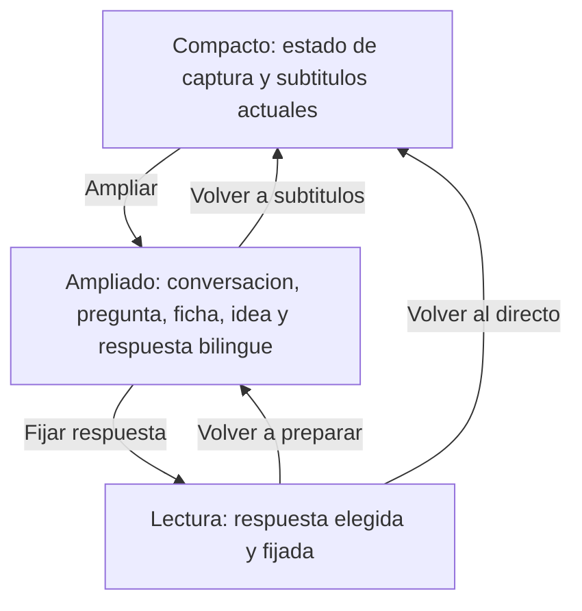
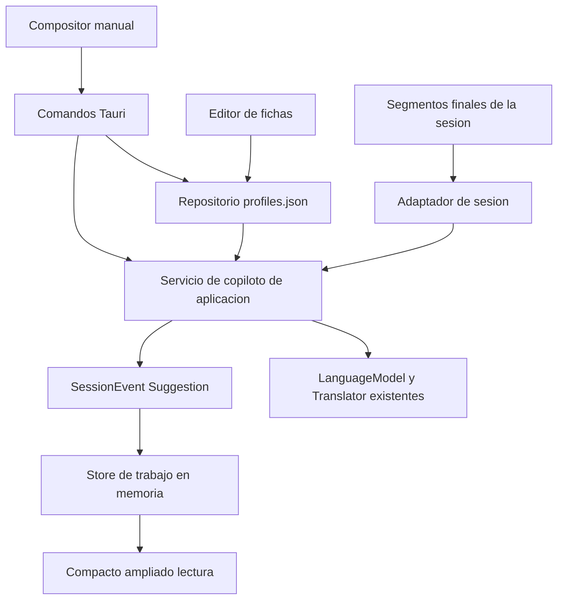
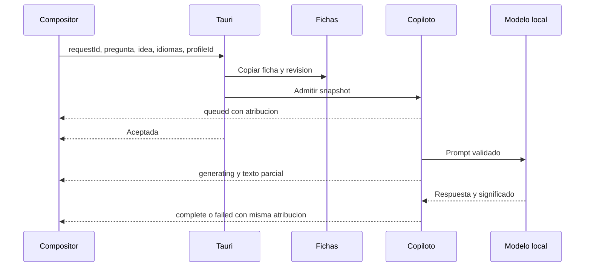
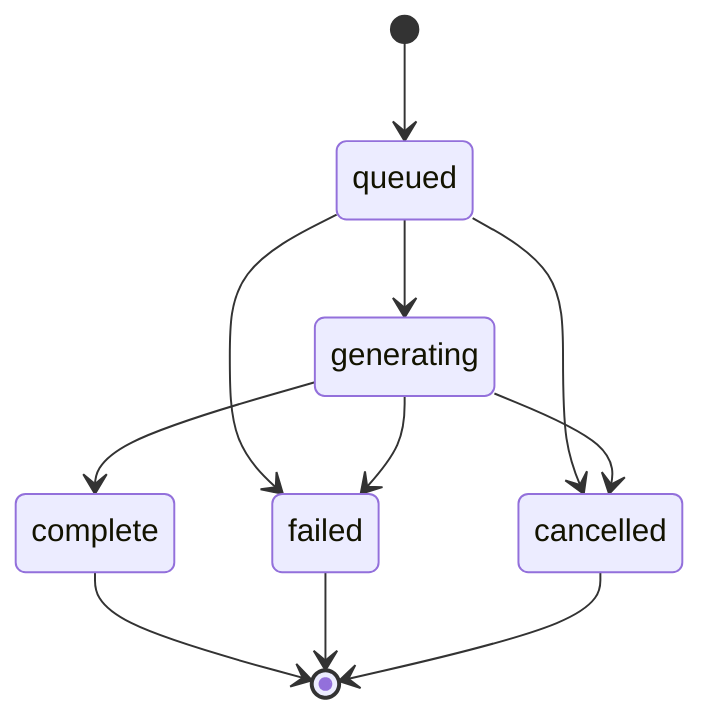
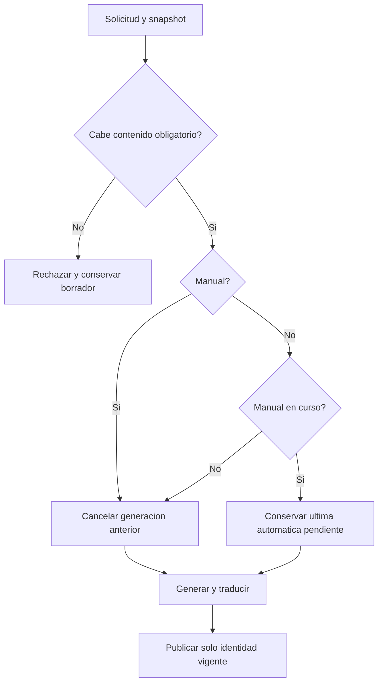

# Ventana adaptable y copiloto tecnico - Plan

## Goal Capsule

- **Objective:** Que un programador pueda comprender y preparar respuestas a preguntas técnicas en otro idioma, durante una reunión o por escrito, usando el contexto de su trabajo.
- **Means:** Una ventana adaptable y un copiloto con fichas locales de proyecto.
- **Product authority:** Alcance confirmado por el usuario el 2026-11-25, tras comparar tres distribuciones y elegir las fuentes de contexto y los usos incluidos.
- **Open blockers:** Ninguno para implementar. La aceptación nativa y la calidad del modelo requieren las verificaciones descritas abajo.
- **Execution profile:** Un cambio local integrado, con planificación, implementación, revisión y correcciones. Por instrucción expresa del usuario: sin commit, push ni PR.
- **Completion owner:** El ejecutor integra las unidades, verifica el resultado y comunica por separado evidencia local y aceptación nativa.
- **Stop conditions:** Un conflicto real con el Product Contract se devuelve al usuario; la ausencia de otra plataforma limita la evidencia de aceptación, no autoriza reducir el alcance.

---

## Product Contract

### Summary

Parlance tendrá una ventana compacta para seguir la conversación que el usuario podrá ampliar para preparar y fijar una respuesta bilingüe.
El copiloto combinará conocimiento técnico, una ficha local de proyecto y la conversación disponible.
El mismo flujo atenderá preguntas escritas o pegadas sin iniciar una captura de audio.

### Problem Frame

El usuario es programador y recibe preguntas sobre herramientas y procesos de trabajo.
Necesita ayuda tanto para formular una respuesta en otro idioma como para elaborar su contenido técnico.
Una explicación general puede servir para hablar de una herramienta, pero no basta para describir las decisiones concretas de su equipo.
También quiere consultar preguntas de cuestionarios por escrito.

### Key Decisions

- **Una ventana adaptable.** Governs R1–R5. (session-settled: user-directed — chosen over un panel lateral permanente y dos ventanas separadas: concentrar la interacción en una ventana que se amplía a demanda.)
- **Conocimiento técnico y contexto aportado.** Governs R6, R8, R13–R17. (session-settled: user-directed — chosen over conocimiento general sin ficha previa y mera reformulación de una idea: adaptar las respuestas a preguntas sobre el trabajo del usuario.)
- **Preguntas en vivo y escritas en la misma versión.** Governs R9–R12. (session-settled: user-directed — chosen over limitar la primera versión a reuniones: cubrir también cuestionarios con el mismo contexto.)
- **Fichas de texto locales.** Governs R13–R17. (session-settled: user-directed — chosen over importar archivos completos desde esta versión: aportar contexto editable y reutilizable sin añadir importación documental.)
- **Trabajo elegido por el usuario protegido frente al directo.** Governs R5, R11, R12. La síntesis confirmada prioriza la respuesta fijada y la consulta manual frente a nuevas sugerencias automáticas.
- **Separar fichas e historial.** Governs R18–R20. La persistencia de contexto no supone consentimiento para guardar conversaciones.

### Requirements

**Ventana y continuidad**

- R1. Parlance ofrecerá los modos compacto, ampliado y lectura de respuesta fijada dentro de una sola ventana.
- R2. El modo compacto priorizará los subtítulos actuales y mostrará el estado real de captura, con acceso al modo ampliado.
- R3. El modo ampliado permitirá consultar la conversación, la pregunta atendida, la respuesta bilingüe, la ficha activa y una idea opcional del usuario para orientar la respuesta.
- R4. Cambiar de modo conservará la sesión, la captura activa, los textos y el trabajo en curso sin reiniciarlos.
- R5. Fijar una respuesta conservará el texto elegido para leerlo hasta que el usuario lo quite o elija otro, sin sustituciones por nuevas preguntas ni actualizaciones automáticas.

**Ayuda tecnica y preguntas**

- R6. El copiloto elaborará respuestas usando conocimiento técnico general, la ficha elegida y el contexto reciente de conversación disponible.
- R7. La salida priorizará una respuesta breve que pueda decirse en voz alta, acompañada de su significado en el idioma del usuario; cuando ambos idiomas coincidan, evitará duplicar el mismo contenido.
- R8. El copiloto distinguirá recomendaciones generales de hechos aportados sobre el proyecto e indicará cuándo faltan datos para responder sobre el equipo.
- R9. Con captura y copiloto habilitados, las preguntas detectadas en la conversación podrán producir sugerencias automáticamente sin cambiar el modo de ventana elegido.
- R10. El usuario podrá escribir o pegar una pregunta, indicar una idea opcional y solicitar una respuesta sin iniciar captura ni conceder permisos de audio para esa consulta.
- R11. Mientras el usuario trabaje en una consulta escrita o en su respuesta, la actividad automática no reemplazará su pregunta, borrador ni resultado visible.
- R12. El usuario podrá revisar, copiar, volver a solicitar una respuesta con una idea corregida y fijar el resultado elegido; ninguna respuesta se enviará ni se pronunciará automáticamente.

**Fichas de proyecto**

- R13. El usuario podrá crear, nombrar, editar y eliminar fichas locales de texto que sobrevivan al cierre de la aplicación.
- R14. Cada ficha admitirá texto escrito o pegado sobre el stack, arquitectura, procesos y decisiones del equipo, sin exigir un esquema técnico al usuario.
- R15. El usuario podrá elegir una ficha activa o ninguna, y cada respuesta identificará qué ficha se usó o que se generó sin ficha.
- R16. Cambiar, editar o eliminar una ficha afectará a solicitudes posteriores sin reescribir respuestas previas ni atribuirles un contexto distinto del utilizado.
- R17. Una solicitud en curso conservará el contexto con el que se inició aunque cambie la ficha activa; la captura continuará durante ese cambio.

**Control, privacidad y estados de uso**

- R18. Crear o utilizar fichas no activará el guardado de transcripciones ni la persistencia automática de preguntas y respuestas; el historial existente seguirá siendo optativo.
- R19. Las nuevas capacidades mantendrán el funcionamiento local después de descargar los modelos, sin cuentas, APIs de pago ni grabación de audio en disco.
- R20. Abrir la aplicación, cambiar de modo o consultar por escrito no iniciará la captura; esta seguirá requiriendo una acción explícita.
- R21. El usuario podrá distinguir una respuesta en preparación de una terminada o fallida, conservando su pregunta e idea para corregirlas o reintentar ante un fallo.
- R22. Cuando el contexto no quepa en la capacidad disponible, Parlance lo hará visible y permitirá reducirlo, sin afirmar que utilizó texto omitido.
- R23. La adaptación conservará el redimensionamiento, el control de siempre visible y la navegación por teclado, con la misma intención funcional en las plataformas de escritorio soportadas.
- R24. El retorno al directo y la lectura de transcripción anterior conservarán su comportamiento existente, sin convertir el modo de ventana en una pausa de captura.

### Key Flows

- F1. **Preparar una reunion. Covers R13–R20.** El usuario crea o edita una ficha, la selecciona y elige los idiomas. Inicia la captura explícitamente cuando esté listo.
- F2. **Escuchar y responder. Covers R1–R9, R12, R21, R24.** El usuario sigue los subtítulos compactos, amplía la ventana ante una pregunta y revisa la sugerencia. Puede orientar otra respuesta con su idea, fijar la elegida y volver al directo manteniendo la sesión.
- F3. **Resolver una pregunta escrita. Covers R6–R12, R15, R20–R22.** El usuario abre el modo ampliado, selecciona una ficha o ninguna y pega una pregunta. Solicita y revisa una respuesta sin activar audio; si ya había una captura, esta continúa sin reemplazar su trabajo manual.
- F4. **Cambiar de contexto. Covers R15–R17.** El usuario cambia de ficha mientras sigue la reunión. Las solicitudes posteriores usan la nueva ficha; la respuesta anterior y cualquier generación en curso mantienen la identificación del contexto original.

La distribución seleccionada se compone así; las regiones describen contenido, no medidas finales:

Los tres estados pertenecen a la misma ventana y cumplen R4; las transiciones no conceden permiso para iniciar captura.

### Acceptance Examples

- AE1. **Covers R1–R5, R9, R24.** Durante una captura, el usuario amplía la ventana, fija una respuesta y vuelve a subtítulos. La sesión no reinicia y la respuesta fijada sigue disponible sin cambios aunque lleguen otras preguntas.
- AE2. **Covers R6–R8, R14, R15.** La ficha de ejemplo dice que el equipo usa Redis para cachear lecturas. Ante esa pregunta, la respuesta respeta el dato; si se pregunta por un TTL que no figura, reconoce que falta información y no presenta un valor inventado como configuración del equipo.
- AE3. **Covers R7, R10, R12, R20.** Sin captura activa ni permisos de audio concedidos, el usuario pega una pregunta y obtiene ayuda con la ficha elegida. Puede copiar el resultado; no aparece un diálogo de audio ni comienza a escuchar. Con idiomas iguales, no se duplica la salida.
- AE4. **Covers R4, R11, R12.** Durante una reunión, el usuario escribe una pregunta y una idea. Una nueva pregunta hablada no borra ese texto ni sustituye la respuesta manual, y la transcripción sigue avanzando.
- AE5. **Covers R15–R17.** Una respuesta comienza con la ficha A y el usuario selecciona B antes de que termine. El resultado conserva A como contexto; una nueva solicitud usa B. Editar o eliminar A no cambia retroactivamente la respuesta.
- AE6. **Covers R13, R18–R20.** Con historial deshabilitado, el usuario guarda una ficha y reinicia la aplicación. La ficha permanece disponible, el historial no se activa y no comienza la captura.
- AE7. **Covers R21, R22.** Una solicitud falla o el contexto aportado supera la capacidad disponible. La interfaz explica el estado sin presentar una respuesta incompleta como terminada, y conserva pregunta e idea para corregir y reintentar.
- AE8. **Covers R23, R24.** El usuario redimensiona la ventana, alterna siempre visible y navega los controles por teclado. Al consultar transcripción anterior y regresar al directo, mantiene el comportamiento existente sin detener audio.

### Scope Boundaries

- Importación de archivos, indexación de repositorios, conectores y sincronización de fichas quedan fuera de esta versión.
- Los cuestionarios se atienden mediante preguntas escritas o pegadas; no se incluye leer pantallas, resolver lotes, completar formularios ni enviar respuestas a otra aplicación.
- No se añade una biblioteca de consultas, historial propio de respuestas, resúmenes de reuniones, tareas automáticas, identificación nominal de hablantes ni reproducción de audio grabado.
- Las otras distribuciones comparadas, panel lateral permanente y ventanas separadas, no forman parte de este alcance.
- No se incluye búsqueda web ni garantía de información actualizada sobre versiones de herramientas. Las respuestas siguen siendo sugerencias que el usuario revisa.
- No se añaden cuentas, colaboración entre usuarios, aplicaciones móviles ni cambios de distribución pública como notarización.

### Dependencies and Assumptions

- El copiloto existente ya produce sugerencias a partir de segmentos finales elegibles y muestra la última salida bilingüe con copia. La extensión requiere preservar la pregunta manual y la respuesta fijada frente a esa sustitución del último resultado.
- La ventana actual es redimensionable y siempre visible por defecto, con control del usuario. El seguimiento del transcript y las preferencias ya existen; no se presentan como capacidades nuevas.
- El guardado de preferencias no implica persistencia de toda la interfaz ni de la geometría de la ventana.
- La calidad de respuestas técnicas y la velocidad con contexto adicional dependen del modelo local y del equipo. La revisión estática no demuestra calidad lingüística, rendimiento concurrente ni aceptación nativa en cada sistema.

### Outstanding Questions

- **Deferred to Planning:** Determinar cómo mantener la transcripción y traducción fluidas mientras se genera una respuesta con contexto, y fijar un presupuesto medible de latencia a partir de los equipos de prueba.
- **Deferred to Planning:** Establecer límites de texto y tratamiento de capacidad para R22 según los modelos locales disponibles.
- **Deferred to Planning:** Definir dimensiones, restauración de geometría y atajos sin conflictos para los modos de R1 y el acceso por teclado de R23.
- **Deferred to Planning:** Concretar persistencia, cancelación y atribución del contexto que satisfagan R13–R18 sin alterar el historial existente.

### Sources and Research

- [Requisitos del producto](../product-requirements.md) y [seguridad](../security.md): autoridades existentes para funcionamiento local, inicio de captura y retención de datos.
- [Ideación de producto](../ideation/2026-11-25-parlance-product-appeal-ideation.html): alternativas de presencia adaptable y ayuda para tomar la palabra.
- [Aplicación actual](../../apps/desktop/src/App.tsx), [configuración de ventana](../../apps/desktop/src-tauri/tauri.conf.json) y [panel del copiloto](../../apps/desktop/src/components/CopilotPanel.tsx): base de interacción verificada estáticamente.
- [Generación del copiloto](../../crates/copilot/src/worker.rs), [contexto reciente](../../crates/copilot/src/context.rs), [estado de sesión](../../apps/desktop/src/store/session.ts) y [preferencias](../../crates/protocol/src/settings.rs): puntos de partida para planificar continuidad y contexto.
- [Seguimiento de transcripción](../../apps/desktop/src/hooks/useStickToBottom.ts): comportamiento existente que gobierna R24.
- [Evidencia de macOS](../benchmarks/2026-11-25-macos.md) y [música y traducción continua](../benchmarks/2026-11-25-music-streaming.md): antecedentes para evitar regresiones de captura y traducción; no certifican esta nueva capacidad.

El boceto temporal elegido fue la opción A. Este documento conserva su comportamiento y es la autoridad de producto aunque el boceto deje de estar disponible.

---

## Planning Contract

Product Contract unchanged. Las preguntas que figuraban como Deferred to Planning se resuelven mediante KTD3–KTD7; las mediciones de hardware quedan en Verification Contract.

### Grounding

La integración actual crea `CopilotWorker` dentro de `Intelligence.listeners` al iniciar audio (`apps/desktop/src-tauri/src/intelligence.rs`).
El worker consume segmentos finales, cancela la sugerencia anterior y publica `SessionEvent::Suggestion` (`crates/copilot/src/worker.rs`).
La nueva consulta escrita necesita desacoplar esa vida útil de la captura, conservando `LanguageModel`, `Translator` y el sidecar existente.
`ServerConfig` configura 8192 tokens compartidos entre dos slots (`crates/llm/src/server.rs`); no son 8192 tokens por petición.
`ServerModel.generate` comprueba cancelación durante SSE, pero no cubre todavía espera de disponibilidad ni envío HTTP (`crates/llm/src/client.rs`).
La store de sesión se reinicia con `starting`; una store separada debe custodiar el trabajo manual y fijado.
`useStickToBottom` mantiene el seguimiento dentro del componente, por lo que esconder la transcripción no debe desmontarlo.
No se necesita investigación externa ni una nueva dependencia de inferencia para este alcance.

### Key Technical Decisions

- KTD1. **Una store de trabajo independiente del audio.** Implementar `store/copilot.ts` para borrador manual, resultado manual, último automático y copia fijada; mantener `store/session.ts` como dueño de audio/transcripción. El `viewMode` es `compact`, `expanded` o `reading`. La store sobrevive a montaje de paneles y eventos `starting`, pero no se persiste en disco. Governs R1–R5, R11, R18, R24.
- KTD2. **Contratos compartidos en Rust.** `crates/domain` define fichas, instantáneas y resultados; `crates/protocol` define solicitudes y las serializa a camelCase con `ts-rs`. U1 es el único creador de estos tipos y sus bindings. Se conserva `SessionEvent::Suggestion` para transportar el resultado enriquecido. El contrato de campos y comandos está en Shared Interfaces. Governs R6–R17, R21–R22.
- KTD3. **El copiloto vive en la aplicación; la conversación pertenece a una sesión.** `Intelligence` mantiene un servicio de copiloto reutilizable y entrega un adaptador `SegmentListener` con una generación de sesión. El adaptador descarta segmentos de generaciones anteriores y limpia conversación al comenzar una sesión nueva. Al terminar audio se cancela solo trabajo automático de esa sesión; el borrador y la generación manual siguen. El contexto reciente de la última sesión queda disponible para una consulta escrita hasta comenzar otra sesión o cerrar la aplicación. El servicio obtiene modelo y preferencias sin llamar a captura, ASR, VAD ni historial. Governs R4, R6, R9–R11, R17, R20.
- KTD4. **Una generación de copiloto a la vez, con prioridad manual.** El servicio mantiene como máximo una generación activa y una pregunta automática pendiente, reemplazable por la más reciente. Una solicitud manual cancela la automática activa y reemplaza una manual anterior. Durante una manual, la detección automática conserva solo la última pendiente; al finalizar la manual se puede procesar. Cancelación afecta disponibilidad del sidecar, envío HTTP y SSE; cada callback además verifica identidad vigente antes de publicar. Cada petición produce un estado terminal, incluso al cancelar, fallar o cambiar el modelo. No se mantienen locks durante inferencia o espera de cancelación. Traducción del transcript conserva su worker separado y puede usar el segundo slot existente. Governs R9, R11, R17, R21.
- KTD5. **Instantáneas de contexto y atribución inmutables.** La ficha activa se copia al aceptar una solicitud, antes de encolarla, con ID, nombre, revisión y texto. El servicio guarda también pregunta, idea, idiomas y conversación seleccionada. Cambiar o eliminar una ficha no muta esa copia. Los eventos devuelven una referencia de ficha con nombre y revisión, nunca requieren consultar la ficha viva para atribuir una respuesta. Seleccionar ninguna produce `profile: null`. Governs R6, R8, R15–R17.
- KTD6. **Persistencia local separada y transaccional.** Un repositorio JSON en `crates/storage` para `profiles.json` bajo el directorio de configuración de Parlance almacena versión de formato, fichas y `activeProfileId` juntos. Usa un mutex que cubre lectura-modificación-escritura y reemplazo mediante temporal; el estado en memoria solo cambia tras guardar con éxito. Una ficha tiene ID estable generado en backend y revisión incremental. Eliminar la activa escribe la lista y selección nula en la misma operación. Un archivo ilegible muestra error y conserva el original, sin reemplazarlo por una lista vacía. No se usan tablas de historial ni se guardan preguntas, ideas, respuestas o audio. Governs R13–R20.
- KTD7. **Capacidad explícita sin recorte silencioso de la ficha.** Guardar permite nombres de 1–80 caracteres y cuerpos de hasta 12000 bytes UTF-8. Cada petición acepta pregunta de hasta 2000 bytes e idea de hasta 1000 bytes, con validación de campos vacíos y límites en backend. El prompt completo renderizado se limita conservadoramente a 3000 bytes UTF-8 y la salida a 160 tokens, dejando margen dentro de cada slot de 4096 tokens. Esta cifra es un límite de aplicación, no una afirmación de tokenización exacta. Si instrucciones, pregunta, idea y ficha completas no caben, se rechaza la petición con `contextTooLarge`, sin inferencia, conservando el borrador para reducirlo. La conversación reciente se añade desde el final hasta el presupuesto restante y `conversationTruncated` informa cualquier omisión. No se utiliza `quote_transcript` para la ficha porque hoy corta contenido por caracteres. Todos los bloques de datos neutralizan delimitadores y declaran que ficha, pregunta y conversación son datos, no instrucciones de sistema. Un rechazo real de capacidad del modelo se presenta como fallo corregible, sin reintento automático con texto omitido. Governs R6, R8, R21–R22.
- KTD8. **Estados visibles y salida completa verificable.** El resultado empieza en `queued`, pasa a `generating` y termina en `complete`, `failed` o `cancelled`. Puede mostrar salida parcial, rotulada como tal. Una traducción fallida deja `failed`, nunca una respuesta bilingüe completa con significado vacío. El cliente SSE exige una terminación válida del servidor; EOF sin terminación y `finish_reason: length` son fallos corregibles con salida parcial, tanto al generar como al traducir. Igual idioma evita la segunda generación. El prompt pide una propuesta técnica breve, diferencia hechos de la ficha de recomendaciones generales e indica datos ausentes. Esta instrucción requiere evaluación con modelo real; los tests de prompts no acreditan veracidad de la respuesta. Governs R7–R8, R12, R21.
- KTD9. **Geometría por modo solo durante la ejecución.** Inicio compacto a 560×320; ampliado a 900×680; lectura a 620×440, en unidades lógicas. Mantener mínimo 440×320, limitar al área visible del monitor y conservar por modo el último tamaño que el usuario eligió durante esta ejecución. Cambiar tamaño no mueve la ventana innecesariamente ni escribe preferencias de geometría. Si la API nativa falla, mostrar aviso y conservar la presentación funcional. Mod+J alterna compacto/ampliado; lectura requiere una respuesta fijada. Mod+Enter dentro del compositor solicita respuesta y no inicia audio. Los atajos de captura/pausa se ignoran en input, textarea y contenteditable; botones de captura siguen disponibles. Governs R1–R5, R20, R23–R24.

### Shared Interfaces

Estos nombres y campos fijan el límite entre U1, U3 y U4; los detalles internos de métodos no forman parte del contrato.
Los tipos de ID de ficha y solicitud son strings opacos; los IDs de sugerencia continúan siendo números, asignados de manera monotónica durante toda la vida del servicio y nunca reiniciados por sesión.

| Tipo | Campos camelCase | Dueño |
| --- | --- | --- |
| `ProjectProfile` | `id`, `name`, `content`, `revision` | domain |
| `ProjectProfiles` | `profiles: ProjectProfile[]`, `activeProfileId: string or null` | protocol |
| `SaveProjectProfileRequest` | `id: string or null`, `name`, `content` | protocol |
| `ProfileSnapshot` | `id`, `name`, `revision`, `content` | domain, interno Rust para generación |
| `ProfileAttribution` | `id`, `name`, `revision` | domain, visible en resultado |
| `AskCopilotRequest` | `requestId`, `question`, `idea`, `replyLanguage`, `userLanguage`, `profileId: string or null` | protocol |
| `SuggestionOrigin` | `automatic` o `manual` | domain |
| `SuggestionStatus` | `queued`, `generating`, `complete`, `failed`, `cancelled` | domain |
| `Suggestion` | Campos existentes; `questionSegmentId` pasa a nullable; añade `requestId`, `origin`, `idea`, `profile: ProfileAttribution or null`, `status`, `error: string or null`, `conversationTruncated` | domain |

`isComplete` continúa en `Suggestion` como compatibilidad con consumidores actuales y es true únicamente para `status: complete`.
`requestId` manual lo genera el cliente antes de enviar; el backend rechaza duplicados activos y asigna uno propio a las preguntas automáticas.
Esto permite correlacionar eventos que lleguen antes de resolverse el comando IPC.
`replyLanguage` siempre es un `LanguageCode` concreto para consultas manuales; el selector se inicializa con idioma fuente configurado o inglés si la fuente es Auto.
`userLanguage` se inicializa con el idioma de destino de preferencias y también queda congelado por solicitud.
El backend resuelve `profileId` desde el repositorio y devuelve error si ya no existe; no confía en contenido de ficha enviado por el frontend.
Las preguntas automáticas toman la ficha activa, idioma detectado/fuente y destino actual al admitirse.

| Comando Tauri | Entrada | Salida |
| --- | --- | --- |
| `list_project_profiles` | ninguna | `ProjectProfiles` |
| `save_project_profile` | `request: SaveProjectProfileRequest` | `ProjectProfiles` |
| `delete_project_profile` | `id` | `ProjectProfiles` |
| `set_active_project_profile` | `id: string or null` | `ProjectProfiles` |
| `ask_copilot` | `request: AskCopilotRequest` | aceptación vacía; progreso por `SessionEvent::Suggestion` |
| `cancel_copilot` | `requestId` | vacía; cancelación idempotente |

Todos se registran en `commands.rs`, `lib.rs`, `build.rs` y permisos/capabilities correspondientes, siguiendo el mapa existente.
Los errores de validación usan `IpcError` y no borran el borrador.
`ask_copilot` responde después de validar/admitir, sin esperar toda la generación.
Si el modelo no está instalado o listo, devuelve un error que permite abrir Ajustes; no solicita permisos de audio ni descarga automáticamente.
La casilla existente `copilotEnabled` gobierna detección automática; una consulta escrita explícita puede usar el modelo aunque esa casilla esté apagada.

### Core Service Boundary

U2 publica `CopilotService` desde `parlance-copilot`; U3 solo compone su modelo, traductor, fuente de fichas y eventos.
El servicio recibe engines compartidos, `EventSink` y política al construirse, sin conocer Tauri ni filesystem.
Expone operaciones conceptuales estables: `submit_manual` admite `AskCopilotRequest` junto al `ProfileSnapshot` ya resuelto; `cancel_request` cancela por requestId; `session_listener` crea un adaptador de sesión con contexto y preferencias actuales; `update_preferences` cambia detección/idiomas para solicitudes posteriores; `shutdown` cancela y espera la tarea activa.
`session_listener` recibe un callback de snapshot de ficha activa provisto por la composición, para que cada pregunta detectada capture la revisión vigente sin reiniciar el listener.
Ese callback solo copia estado de memoria: nunca lee disco ni escribe desde la ruta de ASR.
`submit_manual` captura en el servicio la conversación reciente al admitirse; no acepta una transcripción arbitraria enviada por el cliente.
Los tipos exactos de ownership Rust pueden ajustarse durante integración, manteniendo estos límites y la semántica de Shared Interfaces.
La validación de pregunta/presupuesto vive en copilot; la validación y persistencia de fichas vive en storage; los comandos convierten errores a `IpcError`.
Si se introduce `ContextTooLarge` como variante de error de servicio, el adapter la mapea al código `contextTooLarge` declarado en protocol y la UI la muestra junto al borrador.

### High-Level Technical Design

### Assumptions and Implementation Notes

- Se cubre el Product Contract completo. No se añade buscador, importador, historial de consultas ni otro motor de inferencia.
- Los tamaños de KTD9 son valores iniciales ajustables tras observar legibilidad nativa, no una promesa de tamaño fijo.
- Una ficha en disco puede exceder el presupuesto de una pregunta concreta; guardarla no significa que quepa en toda solicitud. El formulario muestra el límite y el error de solicitud dirige a reducir el contexto.
- El servicio se puede construir de forma perezosa para consultas manuales, aunque traducción y detección automática estén deshabilitadas. Cambiar modelo cancela peticiones con estado visible; cambiar una ficha nunca reinicia el sidecar.
- Desactivar la casilla automática cancela trabajo automático, sin cancelar una consulta manual ni detener audio. Los cambios de idioma afectan nuevas solicitudes, no las que ya se admitieron.
- Para preservar lectura anterior y retorno al directo, `TranscriptView` sigue montado en ampliado y compacto; lectura lo oculta sin desmontarlo. El compacto muestra subtítulos y el indicador de seguimiento existente, sin forzar scroll si el usuario consulta texto anterior.
- Se considera y no se construye un planificador general de prioridades de inferencia: el único slot de trabajo de copiloto y la traducción existente cubren esta versión. Evidencia de degradación reproducible en U6 justificaría una corrección enfocada.
- No existe requisito de persistir geometría ni trabajo manual entre reinicios; añadirlo supondría nueva retención y queda fuera.

### System-Wide Impact

Los eventos pasan de describir únicamente preguntas detectadas a incluir consultas manuales identificables.
El historial existente continúa observando solo transcript/traducciones de sesión.
Los datos de fichas permanecen locales y no se incluyen en logs ni mensajes de error.
La interfaz no sustituye controles actuales de captura, selección de fuente, siempre visible y Ajustes.
La integración debe mantener la compilación de adaptadores macOS, Windows y Linux; la aceptación nativa se reporta por plataforma realmente ejecutada.

---

## Implementation Units

### U1. Contratos y snapshots de contexto

**Goal:** Definir el contrato único que compartirán backend y frontend.
**Requirements:** R6–R8, R10–R17, R21–R22; F3–F4; AE3, AE5, AE7.
**Dependencies:** Ninguna.
**Files:** `crates/domain/src/copilot.rs`, `crates/domain/src/lib.rs`, nuevo `crates/domain/src/profile.rs`, `crates/protocol/src/events.rs`, nuevo `crates/protocol/src/copilot.rs`, `crates/protocol/src/lib.rs`, `crates/protocol/src/error.rs` si requiere código de capacidad, y bindings generados en `apps/desktop/src/bindings/`. Tests en los módulos Rust anteriores.
**Approach:** Crear los tipos de Shared Interfaces y sus exportaciones siguiendo KTD2/KTD5; mantener la forma del evento y aclarar compatibilidad de `isComplete`. No editar bindings a mano.
**Patterns to follow:** `StartSessionRequest`, `Suggestion`, pruebas serde existentes.
**Test scenarios:**

1. Serializar petición manual y evento automático conserva camelCase, nullable y enums esperados.
2. Covers AE5. Una copia de ficha A conserva texto/revisión aunque el objeto de origen sea editado o eliminado.
3. Un resultado manual no inventa `SegmentId`; las actualizaciones mantienen requestId y atribución.

**Verification:** Rust y TypeScript consumen los mismos tipos generados. Este seam verifica contratos, no disponibilidad del modelo.

### U2. Generacion contextual y concurrencia del copiloto

**Goal:** Atender preguntas manuales y automáticas con el mismo generador local.
**Requirements:** R6–R12, R15–R17, R21–R22; F2–F4; AE2–AE5, AE7.
**Dependencies:** U1.
**Files:** `crates/copilot/src/worker.rs`, `crates/copilot/src/context.rs`, `crates/copilot/src/lib.rs`, nuevos `crates/copilot/src/service.rs` y `crates/copilot/src/prompt.rs`, `crates/llm/src/client.rs`, `crates/llm/src/sse.rs`; tests en estos módulos y nuevo `crates/copilot/tests/requests.rs`.
**Approach:** Separar detección de segmento y servicio de solicitudes conforme KTD3–KTD5. Construir prompts y presupuesto según KTD7; aplicar estados KTD8. Extender cancelación del cliente existente a toda su operación asíncrona. Reemplazar tareas ilimitadas por una tarea activa controlada y la pendiente automática descrita en KTD4.
**Execution note:** Escribir primero pruebas deterministas con modelo y traductor controlados por canales; no usar sleeps como prueba de exclusión o ausencia de callbacks tardíos.
**Patterns to follow:** puertos `LanguageModel`, `Translator`, `SegmentListener` y `EventSink` existentes.
**Test scenarios:**

1. Covers AE2. El prompt incluye ficha completa, pregunta e idea en bloques seguros, distingue recomendaciones y hechos, y pide reconocer datos ausentes.
2. Covers AE3. Una petición manual sin segmentos genera respuesta; idiomas iguales no llaman al traductor.
3. Covers AE4. Una pregunta automática durante una manual queda pendiente sin cancelar la manual; múltiples automáticas conservan solo la última.
4. Covers AE5. Cambiar ficha mientras el modelo espera no altera prompt ni atribución.
5. Cancelar antes de readiness, durante HTTP o streaming termina la tarea y bloquea callbacks tardíos; sustituir una solicitud no puede completar la anterior.
6. Covers AE7. Falla de generación o traducción produce `failed`; capacidad excedida no llama al modelo y no recorta ficha/pregunta/idea. EOF prematuro y finalización por límite de tokens nunca producen `complete`, aunque hayan emitido texto parcial.
7. Unicode y delimitadores falsos no rompen UTF-8 ni bloques; omisión de conversación marca `conversationTruncated`.
8. Parar sesión cancela auto y rechaza eventos antiguos, pero permite terminar manual; comenzar sesión nueva limpia conversación anterior.

**Verification:** Tests de concurrencia y prompt pasan sin modelos reales. No acreditan calidad técnica ni velocidad nativa.

### U3. Repositorio de fichas e integracion Tauri

**Goal:** Hacer durables las fichas y habilitar IPC manual sin activar audio.
**Requirements:** R4, R9–R10, R13–R22; F1, F3–F4; AE3, AE5–AE7.
**Dependencies:** U1; U2 para conectar generación. El repositorio puede implementarse en paralelo con U2 tras acordar Shared Interfaces.
**Files:** nuevos `crates/storage/src/profiles.rs` y `crates/storage/tests/profiles.rs`, `crates/storage/src/lib.rs`, `apps/desktop/src-tauri/src/intelligence.rs`, `apps/desktop/src-tauri/src/state.rs`, `apps/desktop/src-tauri/src/commands.rs`, `apps/desktop/src-tauri/src/lib.rs`, `apps/desktop/src-tauri/build.rs`, capabilities/permisos Tauri afectados. Tests de persistencia en `crates/storage/tests/profiles.rs`; ciclo de solicitudes en `crates/copilot/tests/requests.rs`. El crate desktop tiene `test = false`: no alojar allí pruebas que se darían falsamente por ejecutadas ni cambiar ese ajuste de plataforma.
**Approach:** Mantener validación y operaciones de fichas en `crates/storage`, detrás de un puerto de acceso a perfiles reutilizable y testeable. Usar KTD6 para CRUD y selección atómicos. Exponer los comandos definidos y resolver snapshot bajo lock antes de entregar al servicio. `Intelligence` provee servicio manual independiente de `listeners`, y su shutdown cancela solicitudes antes de apagar el servidor. No adquirir el mutex de sesión durante una generación manual. Registrar comandos y permisos juntos.
**Patterns to follow:** `SettingsRepository` para ubicación y JSON; `session_requests` para exclusión de ciclo de audio; `EventHub` para entregas.
**Test scenarios:**

1. Covers AE6. Crear/editar/seleccionar, reinstanciar repositorio y leer conserva fichas; no crea historial ni cambia `historyEnabled`.
2. Dos escrituras concurrentes no pierden fichas; fallar el guardado conserva memoria y archivo previos.
3. Eliminar activa pone selección a null en el mismo guardado; borrar otra conserva selección.
4. Archivo corrupto produce error recuperable y conserva bytes originales.
5. Covers AE3. Pedir respuesta con capture backend que falla si se invoca no llama a listar/iniciar/pedir permisos; falta de modelo da error accionable.
6. Covers AE5. Snapshot A admitido continúa tras editar/eliminar A y seleccionar B; próxima petición usa B.
7. Apagar automático mantiene manual y captura; cambiar modelo cancela de forma visible; cierre impide nuevas peticiones y drena la tarea.

**Verification:** Tests con almacenamiento temporal y puertos controlados pasan; comandos declarados coinciden con permisos. La prueba IPC nativa en U6 verifica el enlace real.

### U4. Compositor, fichas y lectura protegida

**Goal:** Permitir preparar, corregir, copiar y fijar una respuesta sin perderla por eventos automáticos.
**Requirements:** R3–R8, R10–R18, R20–R22; F1–F4; AE2–AE7.
**Dependencies:** U1 para tipos; U3 para verificación integrada. Puede construirse contra el facade pactado.
**Files:** `apps/desktop/src/lib/ipc.ts`, nuevo `apps/desktop/src/store/copilot.ts`, `apps/desktop/src/store/session.ts`, `apps/desktop/src/components/CopilotPanel.tsx`, nuevos `ProjectProfiles.tsx` y `PinnedReply.tsx` en components. Tests `store/copilot.test.ts`, `components/CopilotPanel.test.tsx`, `components/ProjectProfiles.test.tsx`.
**Approach:** Separar pestañas o selección explícita Manual/Directo dentro de ampliado; escribir o elegir manual protege el foco y selección. Mantener borrador de pregunta/idea fuera del componente. `dispatchSessionEvent` entrega sugerencias al dueño nuevo sin reset por captura. La vista identifica ficha/revisión del resultado, muestra parcial/error y permite reintentar; fijar copia un resultado terminado, nunca referencia mutable. Editor de fichas mantiene borrador ante error de guardado y permite seleccionar ninguna. No mostrar contenido técnico de transporte al usuario.
**Patterns to follow:** Zustand existente, componentes Radix y `errorMessage`; controles etiquetados y foco de diálogos.
**Test scenarios:**

1. Covers AE4. Escribir pregunta/idea y recibir actualización automática conserva valores, selección y respuesta manual.
2. Covers AE1. Fijar respuesta, recibir tokens y otra sugerencia, y comenzar otra sesión conserva exactamente texto y atribución fijados.
3. Covers AE3. Enviar usa idioma concreto elegido y no invoca startSession; igualdad de idiomas oculta significado duplicado.
4. Covers AE5. Resultado A muestra A/revisión aunque selector pase a B o A sea eliminada.
5. Covers AE7. Error IPC, contexto grande y fallo de traducción conservan borrador y muestran estado distinto de completado; reintento genera requestId nuevo.
6. Crear, editar, eliminar y seleccionar ninguna actualiza listado solo tras respuesta satisfactoria; errores de disco no borran texto escrito.
7. Un evento tardío de una petición sustituida no toma el lugar del resultado actual; eventos anteriores a aceptación IPC se correlacionan correctamente.

**Verification:** Tests de reducer/store y componentes verifican independencia y controles. El mock IPC no acredita permisos nativos ni calidad del modelo.

### U5. Modos de ventana y teclado

**Goal:** Adaptar la misma ventana conservando captura, transcripción y trabajo manual.
**Requirements:** R1–R5, R20, R23–R24; F2–F3; AE1, AE3–AE4, AE8.
**Dependencies:** U4.
**Files:** `apps/desktop/src/App.tsx`, `apps/desktop/src/components/TitleBar.tsx`, `apps/desktop/src/components/TranscriptView.tsx`, `apps/desktop/src/hooks/useShortcuts.ts`, nuevo `apps/desktop/src/hooks/useWindowMode.ts`, `apps/desktop/src-tauri/tauri.conf.json`, capabilities Tauri de ventana si procede. Tests `App.test.tsx`, `hooks/useShortcuts.test.ts`, `hooks/useWindowMode.test.ts`.
**Approach:** Aplicar KTD1/KTD9 y conservar TranscriptView montado. Compacto enfatiza subtítulos y captura; ampliado muestra compositor/contexto; lectura dedica espacio a copia fijada y ofrece Volver a preparar/Volver al directo. Conservar siempre visible y controles existentes. Separar fallo de resize de éxito de cambio de presentación.
**Test scenarios:**

1. Covers AE1. Alternar todos los modos mantiene identidad de sesión, borradores y fijado, sin llamar start/stop/pause.
2. Covers AE8. Scroll anterior seguido de cambios de modo conserva auto-follow desactivado; Live retorna al final.
3. Covers AE3. Mod+Enter dentro de textarea solo envía consulta; mod+P no pausa audio cuando se escribe. Fuera de campos siguen los atajos existentes.
4. No se entra en lectura sin respuesta fijada; quitar fijado vuelve a ampliado.
5. Resize conserva tamaño por modo, limita al monitor y maneja rechazo de API sin perder controles o captura.
6. Tab, Escape y retorno de foco del editor/dialog funcionan; layouts a 440px no ocultan acciones esenciales.

**Verification:** Tests verifican estado y llamadas a API; comprobación nativa verifica tamaño, monitor, foco y siempre visible.

### U6. Verificacion integrada y documentacion

**Goal:** Comprobar el flujo completo y dejar evidencia honesta de calidad y límites.
**Requirements:** R1–R24; F1–F4; AE1–AE8.
**Dependencies:** U2–U5.
**Files:** `docs/product-requirements.md`, `docs/security.md`, `docs/roadmap.md`, `docs/architecture/overview.md`, `docs/architecture/concurrency.md`, `docs/architecture/ipc.md`, nuevo `docs/adr/0012-adaptive-copilot.md` y nuevo `docs/benchmarks/2026-11-25-adaptive-copilot.md`; ampliar los tests de integración anteriores cuando aparezcan defectos reales.
**Approach:** Ejecutar Verification Contract y corregir regresiones de este alcance. Documentar controles, ubicación/borrado de fichas, retención y límites de capacidad. No tocar distribución pública.
**Test scenarios:**

1. Covers AE1–AE8. Recorrer ejemplos con app nativa y modelos locales disponibles, registrando cada escenario ejecutado y cualquier plataforma no disponible.
2. Evaluar pregunta Redis con dato conocido y TTL ausente, una pregunta técnica sin ficha y una idea corregida; registrar si el modelo respeta hechos e incertidumbre.
3. Medir captura/traducción con y sin consulta manual usando el mismo audio/equipo/modelos; conservar resultados separados de tests simulados.

**Verification:** Reporte enlaza resultados concretos y límites; no presenta source checks como aceptación nativa.

---

## Verification Contract

| Comprobacion | Comando o evidencia | Resultado esperado |
| --- | --- | --- |
| Contratos/core | `cargo test -p parlance-domain -p parlance-protocol -p parlance-copilot -p parlance-llm` | Tipos y escenarios U1/U2 pasan; bindings regenerados |
| Persistencia | `cargo test -p parlance-storage` | CRUD/reinicio/fallos pasan en temporales |
| Contrato global | `cargo test --workspace` y `cargo clippy --workspace --all-targets -- -D warnings` | Pruebas exigidas por reglas del repo y bindings actualizados |
| Tipos frontend | `pnpm typecheck` | Facade y UI concuerdan con Rust |
| Frontend | `pnpm --filter @parlance/desktop test` | Escenarios U4/U5 y pruebas existentes pasan |
| Estilo | `pnpm lint` y `cargo fmt --check` | Sin errores introducidos |
| Integracion Rust | `cargo check --workspace` | Workspace compila en host disponible |
| Build frontend | `pnpm --filter @parlance/desktop build` | Bundle de UI se genera |
| Aceptacion nativa | AE1–AE8 en aplicación Tauri con modelo local | Audio y copia reales, foco, permisos y geometría observados |

El crate `parlance-desktop` excluye pruebas de biblioteca por restricciones del manifiesto Windows; su wiring se comprueba con `cargo check --workspace` y aceptación nativa, sin declarar tests de shell inexistentes.
No ejecutar estas comprobaciones durante planificación.
La prueba de audio compara una muestra de al menos dos minutos idéntica en ambas condiciones, con tres preguntas manuales intercaladas.
Registrar modelo, hardware, TTFT del copiloto, tiempo total y retraso p95 de transcripción/traducción.
Como objetivo de regresión para el equipo de prueba, la consulta manual no debe aumentar el p95 de publicación de transcripción más de 250 ms ni el de traducción más de 1000 ms respecto de la línea base; tampoco debe causar huecos o reinicios de captura.
Estos son presupuestos de validación propuestos, no mediciones ya obtenidas ni garantía universal.
Si fallan, corregir primero el límite de concurrencia/cancelación, repetir la medición afectada y documentar el resultado.
Una plataforma no disponible se declara no ejecutada; no se sustituye por fixtures.

---

## Definition of Done

- U1–U6 satisfacen sus escenarios y mantienen R1–R24 sin reducir los usos acordados.
- Una consulta escrita funciona con captura detenida y no pide permisos de audio.
- Una captura continúa al editar fichas, generar manualmente y alternar modos.
- Las respuestas conservan atribución y la copia fijada no cambia por eventos posteriores.
- Las fichas sobreviven reinicio con historial desactivado; ninguna nueva store persiste preguntas o respuestas.
- La revisión de código y las correcciones necesarias quedan hechas; no quedan intentos abandonados ni controles sin comportamiento.
- Se informa por separado qué verificaciones locales y nativas se ejecutaron, con cualquier limitación concreta de hardware/plataforma.
- No se crea commit, no se hace push y no se abre PR.
